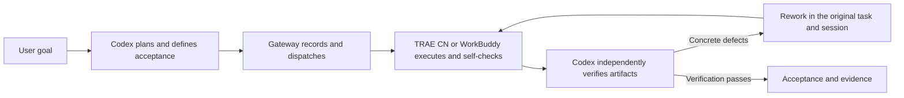

# Codex Agent Gateway

**Codex plans and reviews. TRAE CN / WorkBuddy execute with their own models and tools.**

[中文](README.md) · [Installation](docs/installation.md) · [FAQ](docs/FAQ.md) · [Validation](docs/validation.md) · [Announcement (Chinese)](docs/ANNOUNCEMENT.zh-CN.md) · [Download 0.3.1](https://github.com/zzz123123lll/codex-agent-gateway/releases/tag/v0.3.1)

Codex Agent Gateway connects a Codex supervisor to native desktop agents on Windows. Codex defines the task and acceptance criteria. TRAE CN or WorkBuddy modifies files and runs its own tools. Codex then independently inspects the actual artifacts and behavior, returns concrete correction instructions to the original session, retests, and records acceptance. [Source: project implementation and [architecture](docs/ARCHITECTURE.md).]

## Why this project exists

**Separate execution from final judgment.** An executor's self-check is useful, but its completion report still needs independent review. This workflow assigns planning, review, and acceptance to your chosen Codex supervisor model, while the desktop executor performs the work. The outcome still depends on clear criteria, appropriate checks, and the models you choose. [Source: project design and [executor skill](skills/agent-executor/SKILL.md).]

**Concentrate limited Codex usage on judgment.** TRAE CN and WorkBuddy handle coding, file edits, and commands using the models configured in those products, including supported Chinese models. Codex focuses on task decomposition, review, and acceptance. Reducing Codex usage is a design goal; no measured savings percentage is available. [Source: project design and provider implementation.]



| Role | Responsibility |
| --- | --- |
| User | Sets the goal and scope; handles native login, workspace trust, and tool approvals |
| Codex | Plans, dispatches, independently verifies, requests corrections, and accepts |
| TRAE CN / WorkBuddy | Executes with its own model and tools, producing artifacts and real command records |
| Gateway | Preserves task identity, native session, rounds, state, results, and review evidence |

`completed` means execution has ended. `accepted` means the supervisor has reviewed the result. Rework keeps the original task and native session and clears the previous round's acceptance. The gateway records decisions; the supervisor determines whether the actual deliverable meets its criteria. [Source: task contracts and application orchestration.]

## Capabilities

- Native TRAE CN and WorkBuddy providers, using their desktop sessions, models, and tools.
- Multiple execution–review–correction rounds in the original session.
- Persistent tasks, rounds, identities, and events; artifact digests and separate acceptance evidence.
- Idempotent submission and workspace mutual exclusion. Unconfirmed cancellation or uncertain execution retains its capacity reservation.
- Codex skills, 10 MCP tools, an SDK, a CLI, and a Chinese workbench.
- Windows setup and service management, with a login startup watcher. The service binds to `127.0.0.1` and uses local token authentication.

These capabilities are backed by the implementation and regression checks. A restart watcher alone does not establish unattended stability. [Source: project implementation and [validation](docs/validation.md).]

## Three real GitHub projects

Fresh checkouts of three GitHub libraries were pinned to fixed commits. Native desktop agents implemented additional validation applications. Codex froze independent acceptance checks before dispatch, inspected the artifacts, requested corrections, retested, and formally accepted all three tasks. The difficulty levels refer to the added features; this exercise did not recreate the libraries' entire development histories. [Source: [validation records](docs/validation.md).]

| Project | Executor and deliverable | Frozen independent checks | Final review |
| --- | --- | --- | --- |
| [slugify](https://github.com/sindresorhus/slugify), basic | WorkBuddy: multilingual slug CLI | 21/21 | Accepted |
| [p-limit](https://github.com/sindresorhus/p-limit), intermediate | TRAE CN: bounded-concurrency batch runner and CLI | 37/37 | Accepted |
| [lowdb](https://github.com/typicode/lowdb), higher | WorkBuddy: persistent HTTP application | 52/52 | Accepted |

The final total is **110/110 frozen independent business checks**. Gateway regressions passed **113/113**, and evidence-export helper regressions passed **10/10**. These are separate measurements; executor self-tests and supplementary reviews are recorded separately. [Source: frozen checks, gateway regressions, and report-helper records.]

Real corrections included an invalid slug separator masked by a later argument, missing execution metadata for a successful silent command, uncommitted lowdb writes visible through GET, path constraints, and concurrent shutdown behavior. The lowdb task also exposed WorkBuddy conversation routing and report identity compatibility defects. After gateway fixes, the original task and session produced a verified report and passed independent review in round six. [Source: [rework and acceptance records](docs/validation.md).]

Original failed commands are preserved. Some upstream `npm test`, lint, and build commands encountered Windows or host restrictions; direct and equivalent checks are recorded separately. Passing the 110 business checks does not imply that every original upstream command exited successfully. [Source: [validation scope and command logs](docs/validation.md).]

## Install and run

### Prerequisites

- Windows; Node.js **22.13+** and npm.
- PowerShell 7 (`pwsh`).
- Codex CLI, used by setup to register the local MCP server.
- At least one installed and signed-in **TRAE CN** or **WorkBuddy**, with your chosen execution model configured.

The real-project environment used Node.js 24.15, TRAE CN 3.4.2, and WorkBuddy 5.7.7. Native integration with international TRAE, macOS, and Linux was not tested in this run. [Source: setup checks and [validation environment](docs/validation.md).]

Download and extract a Windows package from [Releases](https://github.com/zzz123123lll/codex-agent-gateway/releases) into a stable directory, or clone the source:

```powershell
git clone https://github.com/zzz123123lll/codex-agent-gateway.git
cd codex-agent-gateway
```

Run setup from the project root, using your actual desktop executable path.

For TRAE CN:

```powershell
pwsh -NoProfile -File scripts/setup.ps1 -CheckOnly -TraeExecutable 'C:\Apps\TRAE\Trae CN.exe'
pwsh -NoProfile -File scripts/setup.ps1 -TraeExecutable 'C:\Apps\TRAE\Trae CN.exe'
```

For WorkBuddy, finish any running work and quit an already-open instance normally through **About → Quit WorkBuddy** first:

```powershell
pwsh -NoProfile -File scripts/setup.ps1 -CheckOnly -WorkBuddyExecutable 'C:\Apps\WorkBuddy\WorkBuddy.exe'
pwsh -NoProfile -File scripts/setup.ps1 -WorkBuddyExecutable 'C:\Apps\WorkBuddy\WorkBuddy.exe'
```

Pass both executable arguments to configure both providers. `-CheckOnly` does not install anything. Full setup installs dependencies, builds and packages the project, configures MCP and two executor skills, and registers and starts a current-user login watcher. It installs the desktop bridge for TRAE CN and configures the local desktop connection for WorkBuddy. Native login, trust, and approvals remain with the user. [Source: setup scripts and [installation guide](docs/installation.md).]

WorkBuddy's local connection requires its startup port. An already-open instance without that port must first be quit normally. Revalidate the connection after desktop product upgrades. [Source: startup implementation and native protocol verification.]

### Give Codex a task

Start a new Codex conversation after installation and use `$agent-executor`. For example:

> Use $agent-executor with WorkBuddy to add JSON persistence and input validation to C:\Projects\my-app. Limit edits to src and test. Define acceptance criteria before dispatch, independently test the result, return concrete defects to the original session, and retest until the criteria pass. Record acceptance and command evidence.

Or choose TRAE CN:

> Use $agent-executor with TRAE to add a maximum of four concurrent jobs, failure isolation, and a result summary to C:\Projects\batch-tool. Independently verify the concurrency limit, failure behavior, and CLI output. Request corrections when needed and accept after retesting.

These are example prompts. Codex needs access to inspect project artifacts and run its checks; the executor uses the model and tools already configured in its desktop product. [Source: [agent-executor skill](skills/agent-executor/SKILL.md).]

Service management:

```powershell
pwsh -NoProfile -File scripts/manage.ps1 status
pwsh -NoProfile -File scripts/manage.ps1 start
pwsh -NoProfile -File scripts/manage.ps1 stop
```

See [installation and management](docs/installation.md) for configuration, upgrades, ports, and uninstalling. Copying `SKILL.md` alone does not install the gateway. [Source: installer and skill.]

## Supported and unverified scope

Version **0.3.1** completed the two-provider, three-project supervision loop on one Windows machine. WorkBuddy's new conversation API, asynchronous report helper, and managed Node identity check under the default configuration root received native verification. The TRAE late-report observer patch passed offline regressions, but that new bridge patch was not installed for a native late-recovery test in this run. [Source: [deployment and validation scope](docs/validation.md).]

Additional machines, 24-hour or longer unattended operation, measured Codex usage savings, international TRAE, and other agent adapters remain unverified. Custom WorkBuddy configuration roots are not automatically supported. The provider architecture, MCP, and SDK offer extension points; the supplied desktop providers are TRAE CN and WorkBuddy. [Source: implementation and validation scope.]

## Documentation, provenance, and contributions

- [Installation](docs/installation.md), [FAQ](docs/FAQ.md), and [architecture](docs/ARCHITECTURE.md).
- [Validation](docs/validation.md): fixed commits, real rework, failed commands, and scope.
- [Rewrite ledger](docs/REWRITE-LEDGER.md) and [provenance](PROVENANCE.md).
- [Project announcement (Chinese)](docs/ANNOUNCEMENT.zh-CN.md).
- [Contributing](CONTRIBUTING.md), [security reports](SECURITY.md), and [third-party notices](NOTICE.md).
- [Issue tracker](https://github.com/zzz123123lll/codex-agent-gateway/issues): include versions, provider, reproduction steps, and sanitized logs.

The current published implementation is licensed under [MIT](LICENSE); dependencies retain their own licenses. Early versions studied and reused foundational implementation from `codex-workbuddy-gateway`. The current core was reimplemented from behavioral specifications, retaining this project's own Windows/TRAE components. [PROVENANCE](PROVENANCE.md) preserves this history and its boundaries. A rewrite ledger is not a legal clean-room or third-party authorization certification. [Source: provenance, rewrite ledger, and license.]

Contributions of reproducible issues, independent acceptance checks, and provider adapters are welcome. Remove tokens, account information, and private paths from public reports. This is an independent project with no official endorsement from OpenAI, TRAE, or WorkBuddy. [Source: project identity and provenance.]
