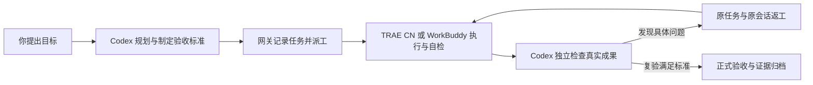

# Codex Agent Gateway

**让 Codex 负责规划与验收，让 TRAE CN / WorkBuddy 用自己的模型和工具完成执行。**

[English](README.en.md) · [安装指南](docs/installation.md) · [常见问题](docs/FAQ.md) · [验证记录](docs/validation.md) · [项目发布介绍](docs/ANNOUNCEMENT.zh-CN.md) · [下载 0.3.1](https://github.com/zzz123123lll/codex-agent-gateway/releases/tag/v0.3.1)

Codex Agent Gateway 是面向 Windows 的本地 agent 协作工具。你在 Codex 中提出目标，Codex 制定任务与验收标准，网关将任务交给 TRAE CN 或 WorkBuddy。执行端实际修改文件、运行自己的工具；Codex 独立检查成果，发现问题后给出具体修复指示，沿用原会话返工，直到满足标准并记录验收。[来源：项目源码、[架构](docs/ARCHITECTURE.md)]

## 为什么做这个项目

**执行者需要自检，交付还需要独立判断。** 同一个模型完成工作后，其“已完成”应进入另一方的检查流程。这个项目把规划、执行、检查和验收明确分开，让你选定的 Codex 监督模型承担裁判职责，让执行端模型承担具体工作。模型能力仍影响结果，独立验收也需要清晰标准和真实检查。[来源：项目设计、[执行技能](skills/agent-executor/SKILL.md)]

**把有限的 Codex 额度集中在判断上。** TRAE CN / WorkBuddy 可以使用各自产品中已经配置的模型和工具，承担编码、文件修改、命令运行等执行工作；Codex 集中负责需求分解、审查和验收。用户可选择执行端支持的国产模型，网关沿用该选择。节约额度是设计目标，目前没有实测节省比例。[来源：项目设计、执行适配源码]

## 一次任务怎样完成



| 角色 | 负责什么 |
| --- | --- |
| 你 | 确定目标、授权修改范围，处理执行端的登录、目录信任和工具审批 |
| Codex | 规划、派工、独立检查、给出返工要求、最终验收 |
| TRAE CN / WorkBuddy | 使用自身模型与工具执行任务，提交成果和真实运行记录 |
| 网关 | 连接执行端，保存任务、会话、轮次、状态、结果与验收证据 |

网关状态 `completed` 表示执行结束；`accepted` 才表示监督端已经验收。返工保留原任务与原生会话，并为新轮次清除旧验收。网关记录这些决定，项目质量由监督端依据实际检查判断。[来源：任务契约、编排与验收源码]

## 能做什么

- **派工到两种执行端**：选择 TRAE CN 或 WorkBuddy，保留执行端自身的模型、工具和桌面会话。
- **完成多轮交付闭环**：检查真实文件与功能，把问题编号、重现方法、期望行为和复验要求一起退回原会话。
- **保存可追踪记录**：任务、执行身份、轮次和事件持久化；结果文件通过摘要固定，验收证据单独保存。
- **减少重复派工**：支持幂等提交、同工作目录互斥；断线、超时或取消尚未确认时保留执行占位。
- **提供多个使用入口**：Codex skill、10 个 MCP 工具、SDK、命令行及中文工作台。
- **在本机管理服务**：Windows 安装、启动、停止和登录启动观察；服务绑定 `127.0.0.1`，使用本地令牌认证。

这些能力来自当前实现及回归验证；登录启动观察和重启协调本身不能证明长期无人值守稳定性。[来源：项目源码、[验证说明](docs/validation.md)]

适合希望由 Codex 监督其他桌面 agent 的个人开发者，以及需要保留派工、返工和验收证据的开发流程。任务越明确，独立功能检查越具体，验收结论越容易复核。[来源：项目定位；后一句为使用建议]

## 三个真实 GitHub 项目，实际执行与验收

本轮重新下载并固定三个 GitHub 仓库的提交，在其上实现新增验证应用。业务成果由 TRAE CN / WorkBuddy 的原生模型与工具完成，Codex 在派工前冻结验收标准，之后独立检查、要求返工并正式验收。这里的难度梯度针对新增功能，不代表复刻了三个库的全部开发历史。[来源：[真实验证记录](docs/validation.md)]

| 项目 | 执行端与实际交付 | Codex 冻结验收检查 | 最终状态 |
| --- | --- | --- | --- |
| [slugify](https://github.com/sindresorhus/slugify)：基础 | WorkBuddy：多语言 slug 命令行工具 | 21/21 | 已正式验收 |
| [p-limit](https://github.com/sindresorhus/p-limit)：中等 | TRAE CN：受限并发批处理与命令行工具 | 37/37 | 已正式验收 |
| [lowdb](https://github.com/typicode/lowdb)：较高 | WorkBuddy：持久化 HTTP 应用 | 52/52 | 已正式验收 |

三个项目共 **110/110 项冻结独立检查通过**。网关自身的自动回归为 **113/113**，报告导出辅助回归为 **10/10**；这些统计分别对应业务验收、网关逻辑和证据导出，执行端自检及补充审查另行记录。[来源：冻结检查、网关回归、报告辅助回归记录]

实际返工包括：修复 slugify 重复参数掩盖非法 separator 的问题；补齐 p-limit 静默成功命令的真实执行证据；修复 lowdb 未提交写入泄露、路径约束和关闭等待等问题。lowdb 还暴露 WorkBuddy 新旧会话接口与回报身份校验的兼容缺陷，网关修复后在原任务、原会话第六轮完成正常回报与独立复验。[来源：[验证说明](docs/validation.md)、各轮返工与验收记录]

原始失败日志保留：Windows 上部分上游 `npm test` / lint / build 命令存在宿主或换行环境限制，相应直接检查和等效检查单独记录。110 项功能验收通过不表示每条原始上游命令都成功。[来源：[原始命令与验证范围](docs/validation.md)]

## 安装与第一次使用

### 准备环境

- Windows、Node.js **22.13 或更高版本**及 npm。
- PowerShell 7，命令为 `pwsh`。
- 已安装的 Codex CLI；安装脚本用它注册本地 MCP。
- 至少一个已安装、已登录的 **TRAE CN** 或 **WorkBuddy**，并已选好执行模型。

本轮实测环境为 Node.js 24.15、TRAE CN 3.4.2、WorkBuddy 5.7.7。国际版 TRAE、macOS 和 Linux 的原生执行适配未在本轮验证。[来源：安装预检查、[实测环境](docs/validation.md)]

### 获取项目

从 [Releases](https://github.com/zzz123123lll/codex-agent-gateway/releases) 下载 Windows 发布包并解压到固定目录，或克隆源码：

```powershell
git clone https://github.com/zzz123123lll/codex-agent-gateway.git
cd codex-agent-gateway
```

以下命令均在项目根目录运行。执行文件路径必须替换为你的实际安装位置。

### 选择执行端并安装

TRAE CN：

```powershell
pwsh -NoProfile -File scripts/setup.ps1 -CheckOnly -TraeExecutable 'C:\Apps\TRAE\Trae CN.exe'
pwsh -NoProfile -File scripts/setup.ps1 -TraeExecutable 'C:\Apps\TRAE\Trae CN.exe'
```

WorkBuddy：先结束正在执行的工作，通过应用中的 **About → Quit WorkBuddy** 正常退出已打开的 WorkBuddy，再运行：

```powershell
pwsh -NoProfile -File scripts/setup.ps1 -CheckOnly -WorkBuddyExecutable 'C:\Apps\WorkBuddy\WorkBuddy.exe'
pwsh -NoProfile -File scripts/setup.ps1 -WorkBuddyExecutable 'C:\Apps\WorkBuddy\WorkBuddy.exe'
```

同时使用两个执行端时，在命令中一起传入两个 Executable 参数。`-CheckOnly` 只检查；正式安装会安装依赖、编译、打包、配置 MCP 和两个执行 skill，并注册及启动当前用户的登录启动观察任务。TRAE CN 安装会部署桌面桥，WorkBuddy 使用其本地桌面连接。原生应用的登录、目录信任与工具审批由你按产品提示处理。[来源：`scripts/setup.ps1`、[安装指南](docs/installation.md)]

WorkBuddy 连接依赖启动时的本机端口；已打开但未启用该端口的实例需要先正常退出。桌面产品升级后，应重新验证连接。[来源：启动脚本、原生接口验证]

### 在 Codex 中开始任务

安装完成后，新建 Codex 对话，使用 `$agent-executor`。例如：

> 使用 $agent-executor，将 C:\Projects\my-app 交给 WorkBuddy 执行。为现有待办应用增加 JSON 持久化和输入校验，只修改 src 和 test。你先制定验收标准，再派工；完成后独立检查。发现问题时给出具体重现与修复要求，在原会话返工，直到检查通过后验收，并保留运行证据。

或指定 TRAE CN：

> 使用 $agent-executor，由 TRAE 执行为 C:\Projects\batch-tool 增加最多 4 个并发任务、失败隔离和结果汇总。你负责独立验证并发上限、失败行为和命令行输出；不通过就返工，复验通过后交付。

以上是使用示例。Codex 需要能读取项目成果并运行检查；执行端仍使用自己已经配置的模型和工具。[来源：[agent-executor 技能](skills/agent-executor/SKILL.md)]

服务管理：

```powershell
pwsh -NoProfile -File scripts/manage.ps1 status
pwsh -NoProfile -File scripts/manage.ps1 start
pwsh -NoProfile -File scripts/manage.ps1 stop
```

高级配置、升级、卸载及端口说明见[安装与管理](docs/installation.md)。复制一个 `SKILL.md` 不能代替完整网关安装。[来源：安装脚本、执行技能]

## 当前支持范围

当前版本 **0.3.1** 已在一台 Windows 上完成两个执行端和三个真实项目的监督验收闭环。WorkBuddy 新 conversation 接口、异步回报和默认配置根下的托管 Node 校验已有本轮原生验证。TRAE 迟到回报观察补丁已通过离线回归，但本轮没有安装该新桥补丁进行原生迟到恢复实测。[来源：[部署与验证范围](docs/validation.md)]

仍需实际验证的范围：第二台电脑、24 小时或更长无人值守、量化 Codex 额度节省、国际版 TRAE 及其他 agent 适配。WorkBuddy 自定义配置根未自动支持。现有 provider 架构、MCP 和 SDK 提供扩展入口；当前发布的桌面执行端为 TRAE CN 与 WorkBuddy。[来源：源码、验证范围]

## 文档、来源与参与

- [安装与管理](docs/installation.md)：环境、执行端、服务和升级。
- [常见问题](docs/FAQ.md)：额度、验收、权限、兼容和使用边界。
- [架构](docs/ARCHITECTURE.md)：任务编排、原生身份、持久化与文件边界。
- [验证说明](docs/validation.md)：固定提交、真实返工、失败日志与验证范围。
- [重写清单](docs/REWRITE-LEDGER.md)与[来源记录](PROVENANCE.md)：实现演进与上游研究来源。
- [完整发布介绍](docs/ANNOUNCEMENT.zh-CN.md)：可复用的项目宣传稿。
- [贡献指南](CONTRIBUTING.md)、[安全反馈](SECURITY.md)与[第三方说明](NOTICE.md)。
- [问题反馈](https://github.com/zzz123123lll/codex-agent-gateway/issues)：请提供版本、执行端、重现步骤和脱敏日志。

当前发布实现采用 [MIT 许可证](LICENSE)，第三方依赖遵循各自许可证。早期版本研究并沿用过 `codex-workbuddy-gateway` 的基础实现；当前核心按行为规范重新实现，并保留本项目自行开发的 Windows / TRAE 部件。来源与历史边界保留在 [PROVENANCE](PROVENANCE.md)。重写记录不构成法律意义上的净室开发或第三方授权认证。[来源：来源记录、重写清单、许可证]

欢迎贡献可复现的问题、独立验收用例和新的执行端适配。反馈时请移除令牌、账户信息及不希望公开的文件路径。本项目是独立开发工具，无 OpenAI、TRAE 或 WorkBuddy 官方背书。[来源：项目定位与来源记录]
